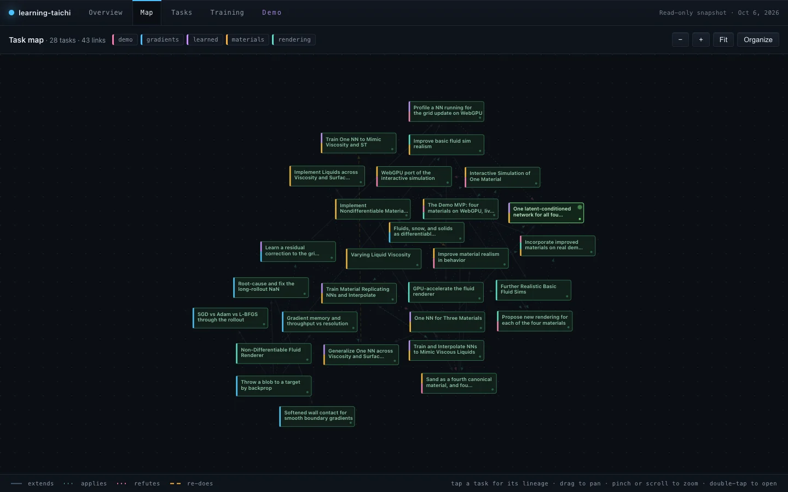

# Learning Taichi

**An automated research system that develops a project alongside its user and teaches them as it goes, like a textbook that writes itself.**

[Open the demo](https://taichi-lab.sevanb.net) · [Project page](https://www.sevanb.net/projects/learning-taichi) · [sevanb.net](https://www.sevanb.net)



This repo is an experiment in handing off most of the labor of a research project to a team of agents, without losing the understanding. The setup is fairly simple. I steer the work from a dashboard, an orchestrator agent breaks each direction into tasks and hands them to worker agents, and everything they find comes back to me as overviews with generative UI built around each task. Simultaneously, the agents extend a textbook specific to the project and my interests. The first subject is differentiable simulation with the Material Point Method in [Taichi](https://www.taichi-lang.org).

The project has two goals:

1. **Learn a new field quickly, and properly.** Not just to end up with a demo, but to be able to explain every part of it, including the math, the design tradeoffs, and what went wrong along the way.
2. **Build the harness itself.** A reusable system for running research with agents, where the bottleneck isn't the labor but how I can actually keep up with the parts that matter.

## How it works

- **Directions and tasks.** The work is organized into directions, each a queue of tasks that I write myself, approve from an agent's proposal, or save for later. All of it lives on a dashboard that I can check from anywhere.
- **One orchestrator, many workers.** A single Claude Code session on `main` expands each task into a brief and spawns worker agents to carry it out. Since everything shares one GPU, it has to schedule them a bit like an operating system schedules a CPU.
- **Every run gets reviewed.** Each task leaves a run on disk with its findings, hypothesis, limitations, figures and videos. Before anything is committed, the orchestrator checks each claim against what was actually tested (agents love to overclaim from a single example) and looks at every figure.
- **The textbook grows with the work.** Each task adds whatever pages it needed, e.g. building from linear algebra and the SVD up through MLS-MPM, differentiating a rollout, and running neural networks inside a GPU kernel.
- **Questions go to an inbox.** When an agent hits a decision that is genuinely mine, it leaves the question in an inbox and moves on to whatever it isn't blocked on, rather than waiting around for me.

The only document the agents never touch is the research report, which I write myself. If I can't explain a result there, it doesn't go on my website. (Note: this feature is not fully fleshed out at the moment.)

## The first project: differentiable MPM

The Material Point Method simulates materials like water, snow, sand and rubber by carrying particles through a background grid at every step, and Taichi makes it possible to differentiate through the entire simulation. That means we can ask a question like *what initial velocity throws this blob onto the target?* and answer it with gradient descent through hundreds of physics steps.

From there the project branched into five directions:

- **Differentiable control:** throwing things at targets by backpropagating through the rollout, and comparing optimizers on a few such tasks.
- **Long-rollout pathologies:** why the gradients blow up into NaNs at long horizons (it turned out to be a float32 overflow from nearly empty grid cells), and how to tame them.
- **Material variants:** water, rubber, snow and sand in one solver, liquids with viscosity and surface tension, and eventually a WebGPU port so that all four run live in the browser.
- **Learned dynamics:** small neural networks that stand in for a material's behavior, and whether a single network can hold several materials at once.
- **Realistic rendering:** turning a cloud of particles into something that reads as liquid.

## Taichi Lab Demo

[taichi-lab.sevanb.net](https://taichi-lab.sevanb.net) is a read-only snapshot of the dashboard. It has a map of every task and how they build on each other, the results of each task, the full textbook, and the Demo tab, where all four materials run on WebGPU and you can push them around. You'll need a browser with WebGPU (recent Chrome, Edge or Safari).

## In this repo

| Folder | What's in it |
| --- | --- |
| `sim/` | the Taichi simulations: forward and differentiable MLS-MPM, the materials, the renderers |
| `runs/` | one folder per task: its manifest, figures and videos |
| `reports/` | the textbook (`training/`) and the research report |
| `coordination/` | directions, tasks, decisions and state: the orchestrator's desk |
| `harness/` | the dashboard (Vite + React), the data server, and the agents' tools |
| `spec/` | who the work is for and how to write it, read by every agent first |

## Run it

```bash
pip install -r requirements.txt
python harness/server/app.py                          # data server on :8732
cd harness/dashboard && npm install && npm run dev    # dashboard on :5174
```

The heavy runs want a CUDA GPU. Built with [Claude Code](https://claude.com/claude-code); the agents read [`CLAUDE.md`](CLAUDE.md) and `spec/` before they do anything.
